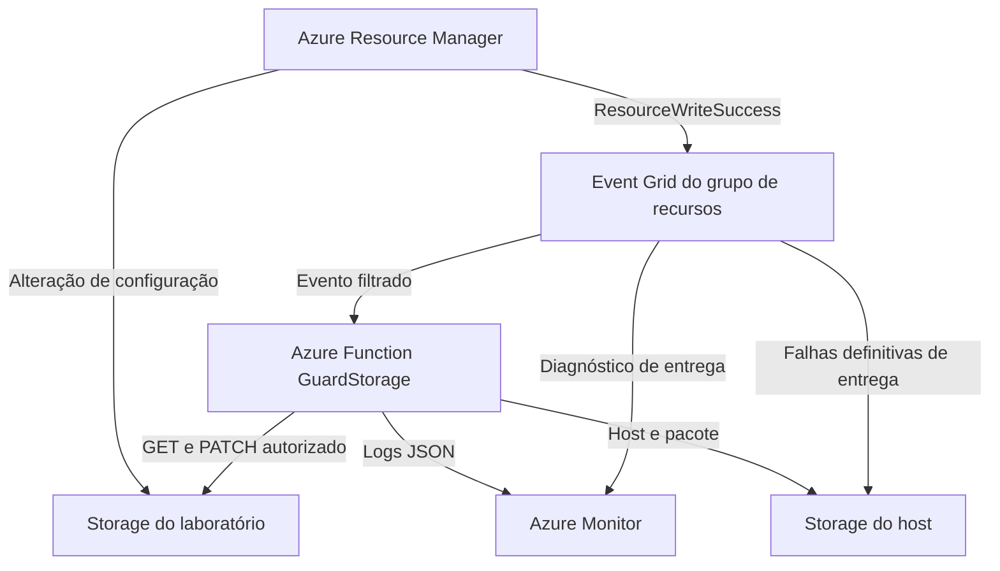

# Azure Storage Incident Response

Laboratório de Cloud Security e DevSecOps que detecta alterações de configuração no Azure Storage, consulta o estado real via Azure Resource Manager (ARM) e aplica uma correção verificável quando autorizada.

**English summary.** This lab uses Azure Event Grid, Azure Functions and Terraform to detect storage account configuration drift. The function checks live ARM state, logs its decision to Azure Monitor and defaults to dry-run. An explicit switch enables a scoped, single-property PATCH. The local replay and unit tests run without Azure credentials.

## Cenário

Um operador altera `allowBlobPublicAccess` de `false` para `true` na conta de laboratório. Essa propriedade permite que contêineres sejam configurados para leitura anônima. Uma exposição pelo endpoint de blobs requer também um contêiner configurado para leitura anônima e um caminho de rede acessível. O laboratório mantém o contêiner vazio e privado, com a rede pública da conta desabilitada. A evidência do exercício é o **desvio de configuração**. [Documentação do Azure Storage](https://learn.microsoft.com/pt-br/azure/storage/blobs/anonymous-read-access-configure)

## Arquitetura



O evento sinaliza uma escrita bem-sucedida. A função valida a versão e os campos do evento, compara o recurso com o ID ARM autorizado e lê a propriedade atual. No modo ativo, envia apenas `{"properties":{"allowBlobPublicAccess":false}}` e verifica o resultado com outro GET. O modo padrão registra `would_remediate` e usa uma identidade sem permissão de escrita na conta monitorada. [Contrato de eventos, permissões e cobertura](docs/architecture.md)

## Rode localmente

Use Python 3.12 ou superior e execute na raiz, em Bash. Os dois comandos usam a biblioteca padrão do Python.

```bash
PYTHONPATH=src python3 -m unittest discover -s tests -v
PYTHONPATH=src python3 scripts/demo.py
```

**Resultado da demonstração sintética**

| Etapa | Evidência | `allowBlobPublicAccess` |
| --- | --- | --- |
| Estado inicial | Contêiner privado e rede pública desabilitada | `false` |
| Desvio | Evento `ResourceWriteSuccess` com operação `Microsoft.Storage/storageAccounts/write` | `true` |
| Dry-run | `detect / would_remediate`, com zero escritas | `true` |
| Remediação | Reprocessamento explícito do evento no simulador. `remediate / verified` após GET de verificação | `false` |
| Duplicata e evento da correção | `no_action / compliant` nos dois casos. Total de uma escrita | `false` |

O script imprime os eventos recebidos, IDs de correlação, decisões e estados em JSON. O payload de entrada está em [fixtures/resource-write-success.json](fixtures/resource-write-success.json). O [roteiro Azure](docs/deployment.md#3-reproduza-o-desvio) mostra como obter as mesmas evidências em uma assinatura.

## Deploy e operação

1. Provisione a infraestrutura em dry-run com Terraform e publique o pacote da função pelo Azure CLI. Habilite a inscrição do Event Grid após confirmar a indexação do trigger. [Implantação e limpeza](docs/deployment.md)
2. Provoque o desvio, confirme `would_remediate` no Azure Monitor e registre a configuração da conta e do contêiner. Depois, habilite o modo ativo e repita a alteração para observar a correção. [Coleta de evidências](docs/deployment.md#3-reproduza-o-desvio)
3. Use o ID de correlação para localizar o autor da alteração no Activity Log e o ID do evento para acompanhar as decisões. [Runbook e pausa da remediação](docs/runbook.md)

Para o volume da demonstração, a estimativa em West Europe é **abaixo de US$ 1 por mês**, com consumo proporcional ao uso. [Premissas, tarifas e limites](docs/deployment.md#estimativa-de-custos)

## DevSecOps

A cada pull request, o GitHub Actions executa testes Python, replay sintético, Ruff, verificação do binding e auditoria das dependências fixadas com hash. O CI também executa formatação, validação e planos com provedor simulado do Terraform, Trivy para IaC e Gitleaks no conteúdo e nos commits. As Actions usam SHAs completos e o token do workflow só tem acesso de leitura ao conteúdo. O deploy é manual, via Azure CLI. [Workflow](.github/workflows/ci.yml)

| Caminho | Conteúdo |
| --- | --- |
| `infra/` | Terraform, lock do provedor, exemplo de variáveis e testes dos controles |
| `src/` | Trigger Event Grid, lógica de decisão e cliente ARM |
| `tests/` e `fixtures/` | Casos de teste e evento sintético |
| `scripts/` | Replay local, empacotamento e deploy da Function |
| `docs/` | Arquitetura, roteiro Azure, consultas KQL, runbook e evidências de validação |
| `.github/workflows/` | Pipeline de CI |

## Publique no GitHub

1. No GitHub, crie um repositório vazio chamado **azure-storage-incident-response**. Deixe as opções de inicialização com README, licença e `.gitignore` desmarcadas, pois o primeiro commit será enviado do seu computador. [Guia do GitHub](https://docs.github.com/en/get-started/git-basics/adding-locally-hosted-code-to-github)
2. Extraia o ZIP e abra a pasta `azure-storage-incident-response` no terminal. Faça o primeiro commit.

   ```bash
   git init -b main
   git add .
   git diff --cached --stat
   git commit -m "Add Azure Storage incident response lab"
   ```

3. Copie a URL HTTPS ou SSH do repositório vazio e cole quando solicitado. Depois, abra a aba **Actions** para acompanhar o primeiro CI.

   ```bash
   read -r -p 'URL do repositório GitHub: ' REPO_URL
   git remote add origin "$REPO_URL"
   git push -u origin main
   ```

Veja [validação e evidências](docs/validation.md) para distinguir a execução local, a simulação e o que requer uma assinatura Azure.
